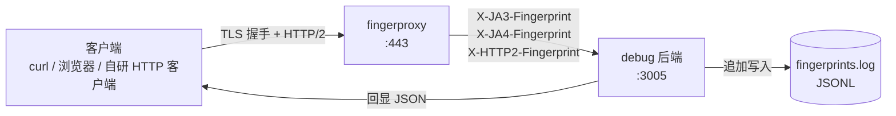

# Fingerprint Debug Collector

一个用于采集客户端 TLS / Akamai HTTP/2 指纹 / JA3 指纹 / JA4 指纹 / 完整请求头/ 客户端 IP 与 User-Agent 并写入日志的调试器。

采集内容：

- JA3 指纹及哈希
- JA4 指纹
- Akamai HTTP/2 指纹
- 完整请求头
- 客户端 IP 与 User-Agent

---

## 架构
- `fingerproxy_linux_amd64`：TLS 指纹转发代理。在 TLS 层握手时解析客户端 ClientHello，得到 JA3 / JA4；在 HTTP/2 层解析 SETTINGS 与 priority 帧，得到 h2 指纹。随后把这些指纹以请求头的形式注入，再转发给后端。
- `debug.go`：零依赖后端。把每条请求的指纹、UA、IP、完整请求头写成一行 JSON（JSONL），同时原样回显。

两者配合，可以确认"客户端声称的指纹"与"服务端实际看到的指纹"是否一致。

## 工作原理



fingerproxy 不修改客户端发来的 ClientHello，而是先记录其特征，再用同样的 ClientHello 特征向后端发起连接，因此后端看到的 TLS 指纹就是客户端原本的指纹。

## 目录结构

```
.
├── fingerproxy_linux_amd64   # 预编译代理，Linux x86_64
├── debug.go                  # 指纹记录后端，监听 :3005
└── fingerprints.log          # 运行后生成，JSONL 日志
```

## 快速开始

### 1. 启动后端

```bash
go build -o debug debug.go
./debug
```

后端固定监听 `:3005`，日志写入 `/root/fingerprints.log`（路径写死在代码里，需要改目录请自行修改后重新编译）。

### 2. 准备证书

代理需要一个 TLS 证书来接受客户端连接，自签即可：

```bash
openssl req -x509 -newkey rsa:2048 -nodes \
  -keyout key.pem -out cert.pem -days 365 \
  -subj "/CN=127.0.0.1"
```

### 3. 启动代理

```bash
chmod +x fingerproxy_linux_amd64
./fingerproxy_linux_amd64 \
  -listen-addr :443 \
  -forward-url http://127.0.0.1:3005 \
  -cert-filename cert.pem \
  -certkey-filename key.pem
```

每个参数都有对应的环境变量，也可以不写参数直接启动：

```bash
export LISTEN_ADDR=:443
export FORWARD_URL=http://127.0.0.1:3005
export CERT_FILENAME=cert.pem
export CERTKEY_FILENAME=key.pem
./fingerproxy_linux_amd64
```

完整参数列表以程序自带的帮助为准：

```bash
./fingerproxy_linux_amd64 -h
```

常用参数：

| 参数 | 环境变量 | 说明 |
| --- | --- | --- |
| `-listen-addr` | `LISTEN_ADDR` | 代理监听地址，如 `:443` |
| `-forward-url` | `FORWARD_URL` | 后端地址，如 `http://127.0.0.1:3005` |
| `-cert-filename` | `CERT_FILENAME` | TLS 证书路径 |
| `-certkey-filename` | `CERTKEY_FILENAME` | 私钥路径 |
| `-preserve-host` | `PRESERVE_HOST` | 转发时保留客户端原始 Host |
| `-verbose` | `VERBOSE` | 输出更详细的运行日志 |
| `-metrics-listen-addr` | `METRICS_LISTEN_ADDR` | Prometheus 指标监听地址 |

### 4. 发起一次验证请求

```bash
# 自签证书需要用 -k 跳过校验，否则在 TLS 阶段就会失败
curl -k -v https://127.0.0.1:443/
```

终端会直接打印后端返回的 JSON；同时日志追加了一行：

```bash
tail -n 1 /root/fingerprints.log | jq .
```

## 后端接口与日志格式

后端对任意路径、任意方法都返回同一条记录：

```json
{
  "time": "2026-11-01T12:00:00+08:00",
  "ip": "127.0.0.1:50000",
  "ja3": "771,4865-4866-4867-...,0-11-12-...,29-23-24-25,0",
  "ja4": "t13d1516h2_...",
  "h2": "1:65536;2:0;4:6291456;6:262144|15663105|0|m,a,s,p",
  "ua": "curl/8.5.0",
  "headers": {
    "X-Ja3-Fingerprint": ["..."],
    "X-Ja4-Fingerprint": ["..."],
    "X-Http2-Fingerprint": ["..."],
    "...": ["..."]
  }
}
```

| 字段 | 含义 |
| --- | --- |
| `time` | 接收时间（RFC3339） |
| `ip` | 优先取 `X-Forwarded-For`，否则取 `RemoteAddr` |
| `ja3` | TLS ClientHello 的 JA3 字符串 |
| `ja4` | TLS ClientHello 的 JA4 字符串 |
| `h2` | HTTP/2 指纹，Akamai 格式（SETTINGS / WINDOW_UPDATE / priority / pseudo-header 顺序） |
| `ua` | 客户端 `User-Agent` |
| `headers` | 完整请求头，便于排查头部顺序与取值 |

> `headers` 会原样记录 Cookie、Authorization 等敏感信息，日志文件的访问权限与脱敏需要自行管理。

## 使用场景

- 校验自研 HTTP 客户端的 TLS/HTTP2 指纹是否与目标浏览器一致。
- 排查"本地抓包正常、服务端判定异常"的头部顺序、扩展列表、SETTINGS 差异。
- 采集真实的浏览器指纹

## 部署注意事项

- 代理默认不校验上游 HTTPS 证书，生产环境请按需收紧。
- `:443` 与 `/root/fingerprints.log` 都需要相应权限；容器内运行时注意挂载目录。
- 日志为纯追加写入且无轮转，长期运行请配合 `logrotate` 或定期截断。
- 不要在公网暴露该服务：任何人都可以通过它记录指纹并回显请求内容。
- 后端对 `X-Forwarded-For` 完全信任，仅适合放在内网或受控网络中。

## 编译

```bash
# 后端（无第三方依赖，需要 Go 1.21+）
go build -o debug debug.go
```

`fingerproxy_linux_amd64` 为预编译二进制产物，直接运行即可；如需自行构建，请参考上游仓库的构建方式。

## 致谢

代理实现参考上游 [fingerproxy](https://github.com/wi1dcard/fingerproxy/releases)，许可证与细节请以其仓库为准。

## 免责声明

本工具仅用于对你**自有且已授权**的服务与客户端进行指纹兼容性调试。请勿用于未授权的目标。
